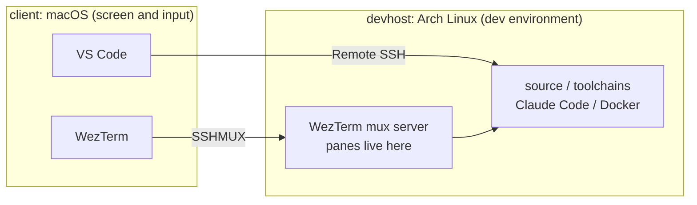
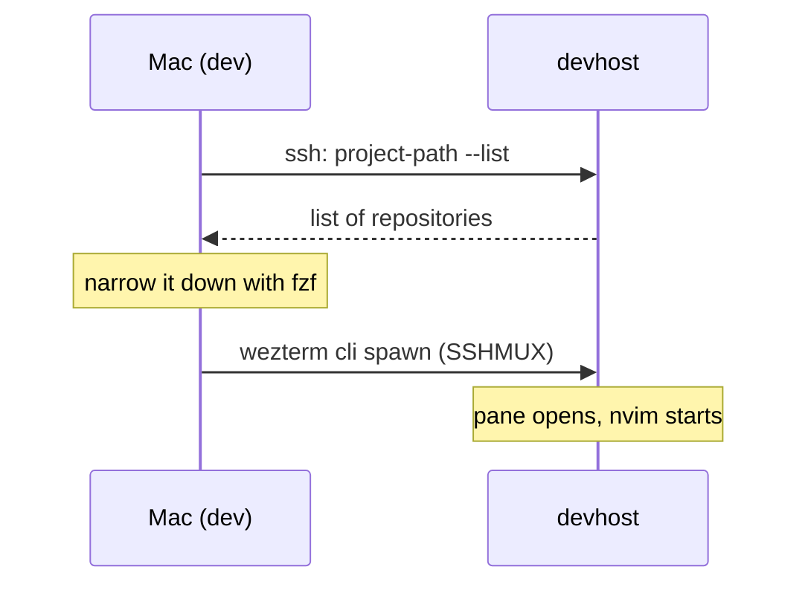

Homebrew and pacman both told me my WezTerm was `20240203`. They were not the same build, and WezTerm's SSH multiplexing will not connect unless both ends speak the same protocol version.

That was the first of three things that broke when I stopped developing on two machines and split them by role instead: the Mac is a screen and keyboard, the Arch Linux box is the only dev environment. Every one of the three was a boundary problem, and once I saw that, debugging got much easier.

All the config lives in my dotfiles: https://github.com/hidetzu/dotfiles

## The setup

I used to keep both machines dev-ready. That meant two toolchains, two checkouts, two installs of every AI CLI, all kept in sync by hand. When they drifted, something worked on one machine and broke on the other.

So I split them:

- **Mac (`client`)** — the screen and the input. No development happens here
- **Arch (`devhost`)** — source, toolchains, LSP servers, Docker, Claude Code. All of it lives only here



The terminal talks to the devhost over WezTerm's SSH multiplexing, and VS Code uses its Remote SSH extension. The dotfiles follow the same split:

| Role | Machine | What goes there |
|---|---|---|
| `client` | macOS | WezTerm, VS Code Remote SSH config, Brewfile |
| `devhost` | Arch Linux | Source, LSP servers, WezTerm mux server, Claude Code |
| `common` | Both | git, fish, starship, Neovim config |

The Mac still gets my shell and editor config. But **code only runs on the devhost**. The one thing both machines must agree on is the piece that connects them: WezTerm.

### Why SSHMUX

I had moved from tmux + Alacritty to WezTerm, and at first I reached the devhost with plain `ssh`. Drop the connection and the panes died with it. Leaving tmux had cost me the one thing tmux was there for.

WezTerm's **SSHMUX** gets it back. It starts a WezTerm mux server on the remote host over SSH — a server that holds the panes and shows them to whichever client connects. `SSHMUX:` is the prefix WezTerm gives this kind of domain.

```lua
-- client/config/wezterm/wezterm.lua
table.insert(config.ssh_domains, {
    name = "SSHMUX:" .. host,
    remote_address = host,
    multiplexing = "WezTerm",
    remote_wezterm_path = "~/.local/bin/wezterm-mux",
})
```

The panes live on the devhost, and the Mac only displays them. That is the role split, enforced by the terminal:

- Lose the network or close the laptop, and the panes survive on the devhost
- Splits and new tabs are created on the devhost, in the same directory
- No tmux in between, so there is one set of tabs and panes, not two

### A `dev` command that follows the split

I open projects with a small `dev` command, and it is split the same way:

```console
$ dev dotfiles     # open the devhost's dotfiles in Neovim, in a new tab
$ dev -c dotfiles  # open it in VS Code over Remote SSH
```



- **The devhost knows what exists.** The candidate list comes from it
- **The Mac chooses.** fzf runs locally. Running it over SSH adds a round trip to every keystroke
- **The devhost opens.** The pane is created there through SSHMUX

## What broke at the boundary

Splitting the roles puts a boundary between the machines. Things that used to happen on one machine now cross it. Three of them broke.

### 1. Same version string, different builds

The SSHMUX client and server compare a mux protocol version (WezTerm calls it the codec version) when they connect. If it differs, the client refuses with an `IncompatibleVersionError`.

Leaving this to the package managers did not work. Homebrew's stable `wezterm` cask is `20240203-110809`. Arch's package also says `20240203`, but read the whole string:

```console
$ pacman -Q wezterm
wezterm 20240203.110809.5046fc22.r869.g76b606ec5-3
$ /usr/bin/wezterm --version
wezterm 20260716-195552-76b606ec
```

`r869` is 869 commits past the `20240203` tag. Arch ships a git snapshot under the old release name, and the binary reports a 2026 build. Same label, different program.

So I install **the same nightly build on both sides, explicitly**. Not because I wanted the latest features — it was the simplest way to guarantee both ends are identical.

- Mac: the Homebrew cask `wezterm@nightly`
- devhost: the same build, extracted from the AppImage to `~/.local/bin` by a script (`wezterm-mux-install`). The pacman package stays untouched
- A third script, `wezterm-match`, checks that they agree

```console
$ wezterm-match
client: 20261010-083911-e2a98e1b
arch: 20261010-083911-e2a98e1b
ok: same build
```

WezTerm publishes nightlies under a single `nightly` release tag that is overwritten each time, so only the latest build is downloadable. Upgrading means upgrading both sides together.

### 2. The Mac's environment leaks into the devhost

When `wezterm cli spawn` on the Mac passes a command to a new devhost pane, it sends the Mac's environment along with it:

```console
$ wezterm cli spawn --domain-name SSHMUX:arch --cwd /tmp -- \
    sh -c 'echo "HOME=$HOME"; echo "SHELL=$SHELL"; sleep 30'
```

```text
HOME=/Users/kawashima
SHELL=/opt/homebrew/bin/fish
```

Neither path exists on Arch. Without `--cwd`, the devhost tries to start in that `HOME`, finds no such directory, and the pane never starts.

So `dev` spawns the pane with no command, then types `nvim .` into it. A pane opened that way builds its environment on the devhost:

```text
HOME=/home/kawashima
SHELL=/usr/bin/bash
```

### 3. The devhost's knowledge doesn't reach the Mac

The leak also runs the other way.

- **Copying the last command's output.** My shell emits OSC 133, the escape sequences that tell the terminal where the prompt ends and the output begins. That information lives in the devhost's mux server and never reaches the Mac, so the copy that worked in local panes does nothing. This is WezTerm [#5141](https://github.com/wezterm/wezterm/issues/5141), "Jump to semantic regions not working through non-local domains", still open. I replaced it with a copy that finds my starship prompt in the screen text and cuts from there
- **Neovim's clipboard.** OSC 52 can push text to the Mac's clipboard just fine. But my config decided "am I over SSH?" by checking `SSH_TTY`, and SSHMUX panes don't have it. I changed the check

Both features quietly assumed the terminal and the shell were on the same machine. The role split broke that assumption.

## Trade-offs

| Gave up | Got |
|---|---|
| Connecting from any terminal (this is WezTerm-only now) | One dev environment, in one place |
| Not caring about WezTerm versions | WezTerm is the only thing to keep in sync |
| macOS notifications (the unsigned nightly doesn't show them in my setup) | Panes that survive a dropped connection |

There is an escape hatch. Next to `SSHMUX:arch` I keep a plain SSH domain, `SSH:arch`, with no mux. If the builds ever drift apart, I connect through that. The panes won't survive a disconnect, but work doesn't stop.

> **Note:** Tested with WezTerm nightly `20261010-083911-e2a98e1b` on both machines; the devhost's pacman package is `20240203.110809.5046fc22.r869.g76b606ec5-3`. Each experiment was run once, by hand. I have not hit the version-mismatch error myself — I matched the builds from day one.

## The boundary is the debugging map

Every failure above came from splitting one machine into two:

- **What must match:** WezTerm, the one thing connecting both sides
- **What leaks in:** the Mac's environment variables, into devhost panes
- **What doesn't come out:** state that lives on the devhost, like semantic zones and `SSH_TTY`

If you move to a thin-client setup, decide what lives on which side first. When something breaks, ask which boundary it crossed and in which direction. That question found all three of mine.
